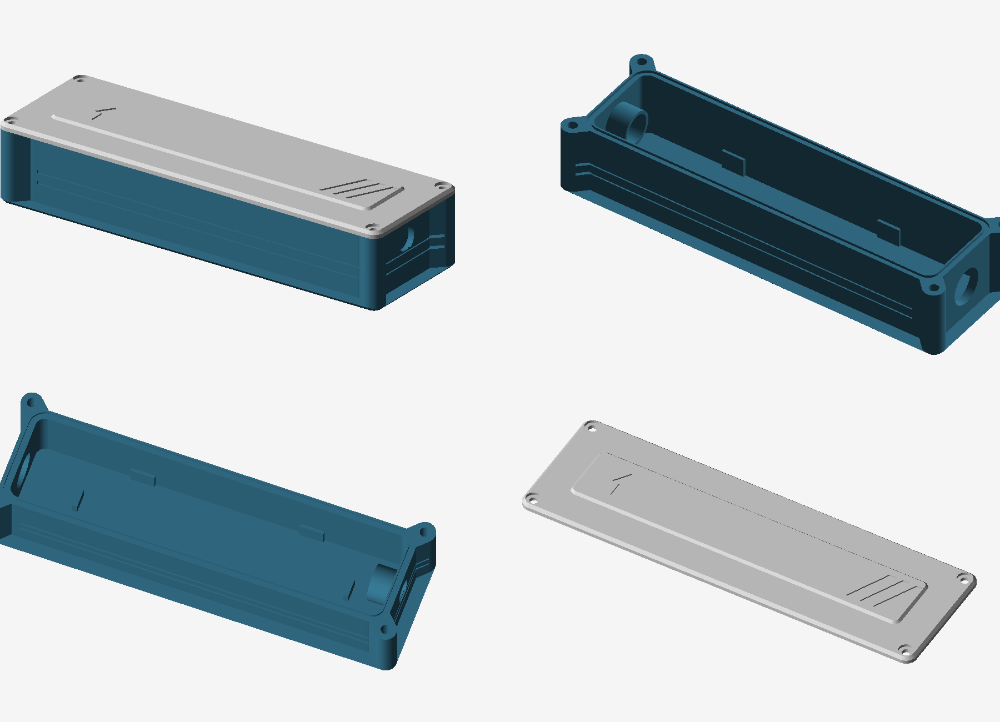

# Boîtier imprimé 3D (version compacte)

Fichiers prêts à imprimer :

- `boitier_fond.stl` : 174 × 54 × 30 mm hors tout
- `boitier_couvercle.stl` : 174 × 54 × 7 mm, s'imprime face extérieure sur le plateau

Le modèle est paramétrique : il suffit de modifier les cotes en haut de `boitier.py`, puis de relancer
`python3 boitier.py` (dépendances : `pip install manifold3d trimesh numpy`).

## Implantation

| Zone (dans la longueur) | Contenu |
|---|---|
| 0–24 mm | arrière de l'embase M12 + fils |
| 24–136 mm | carte LilyGO T-SIM7600G-H (111 × 33 × 20 mm, accu 18650 dessous), calée par butées et nervures |
| 136–156 mm | buck Pololu D24V22F5 + module CAN SN65HVD230, à plat (adhésif VHB), buzzer Ø12 au-dessus |

Volume intérieur 156 × 36 × 28 mm. Antenne GPS et antenne LTE collées sous le couvercle (flèche gravée = côté ciel).

## Ce qui a changé par rapport à la première version

| Avant | Maintenant | Pourquoi |
|---|---|---|
| Embase Deutsch DT04-6P-L012 (collerette 55 × 35,5 mm) | Embase **M12 5 broches codage A**, filetage PG9 | la collerette Deutsch imposait 53 mm de hauteur intérieure ; le M12 ne demande qu'un trou de 15,4 mm |
| Buck encapsulé ~46 × 27 mm | **Pololu D24V22F5** 17,8 × 17,8 mm | 4 fois plus petit, 5,3–36 V en entrée, protégé contre l'inversion de polarité |
| Fusible dans le boîtier | Fusible **dans la rallonge**, côté prise du jet-ski | protège tout le câble et libère de la place |
| Collerette de vis tout autour | 4 colonnes d'angle, à l'extérieur du joint | même étanchéité, encombrement réduit |

Résultat : environ 175 × 54 × 37 mm fermé, contre 178 × 110 × 64 mm avant.

## Connecteur M12 : brochage CANopen standard

| Broche M12 | Couleur câble CANopen | Signal |
|---|---|---|
| 1 | (blindage) | non raccordé, ou masse |
| 2 | rouge | +12 V |
| 3 | noir | masse |
| 4 | blanc | CAN-H |
| 5 | bleu | CAN-L |

C'est le brochage normalisé CANopen/DeviceNet en M12 : un câble CANopen M12 du commerce coupé en deux sert
directement de rallonge. Au bout côté jet-ski : fusible 1 A en ligne sur le fil rouge, puis la fiche Deutsch
qui correspond à la prise diagnostic (genre et brochage à relever au multimètre, doc 02).

## À acheter en plus

- 1 embase M12 femelle 5 broches codage A, montage arrière, filetage PG9, à souder (IP67)
- 1 câble CANopen M12 mâle 5 broches (sert de rallonge) + fiche Deutsch côté jet-ski + porte-fusible 1 A
- 4 inserts thermo M3 (longueur 5–6 mm) + 4 vis M3 × 8 tête cylindrique
- 0,5 m de cordon silicone Ø1,5 mm
- Adhésif double face VHB pour le buck et le module CAN

## Impression

- **ASA** (résiste aux UV et à la chaleur) ou **PETG** au minimum. Le PLA est à éviter.
- 4 périmètres minimum, 5 couches dessus/dessous, remplissage 40 %. Une paroi FDM fine laisse passer l'eau.
- Sans support. Le logement du buzzer est en porte-à-faux sur la paroi : vérifier l'aperçu du trancheur.

## Cotes vérifiées

| Pièce | Cote utilisée | Source |
|---|---|---|
| Embase M12 PG9 | perçage Ø15,3 +0,1 mm, paroi 4 mm max (la nôtre : 3,6 mm) | fiche fabricant embase M12 arrière PG9 |
| Brochage M12 CANopen | 2 V+, 3 V−, 4 CAN_H, 5 CAN_L | fiches Phoenix Contact / ESCHA |
| Pololu D24V22F5 | 0,7″ × 0,7″ × 0,31″, entrée 5,3–36 V, 2,2 A continu | pololu.com |
| Carte LilyGO | 111 × 33 × 20 mm | manuel / fiche revendeur — à mesurer |

## À vérifier avant d'imprimer

- **Cotes de la carte** : mesure ta carte. Si elle diffère, ajuste `BOARD_L` / `BOARD_W` / `BOARD_H`.
- **Embase M12** : vérifie que celle que tu achètes est bien en PG9 (certaines sont en M16 : perçage 16,1 mm,
  changer `M12_HOLE`).
- **USB-C** : on flashe couvercle ouvert ; un câble USB-C coudé est plus pratique dans un boîtier de 36 mm de large.
